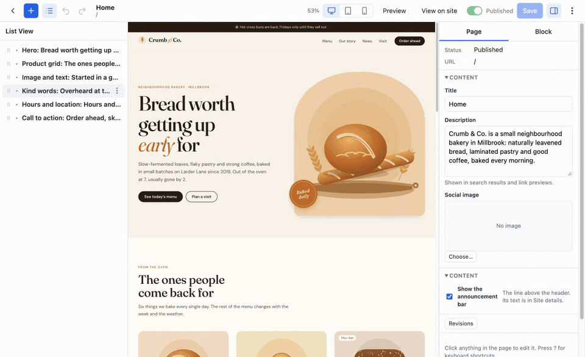

<p align="center">
  
</p>
<h1 align="center">PageStack</h1>

<p align="center">
  <strong>A block editor for Astro sites. Your content stays in your repo.</strong><br>
  Click a heading on the real page and type. Drag sections around. Press Save, and it's a git commit.
</p>

<p align="center">
  <a href="https://www.npmjs.com/package/@pirateandfox/pagestack"></a>
  <a href="LICENSE"></a>
  
</p>

<p align="center">
  
</p>

## Why

Static Astro sites are fast, cheap and hard to break, and the people who write for them usually
can't touch them. The usual fix is a headless CMS: another service, another login, content in
someone else's database, and a site that no longer builds from the repo alone.

PageStack takes the other route. It adds an editor **to the site itself**:

- **Edit on the real page.** The preview is your site, rendered by your own components. Click text to
  change it, click an image to swap it, press **+** or **/** to add a block. If you've used the
  WordPress block editor, you already know it.
- **Content is files in your repo.** Pages are JSON, posts are Markdown. Saving writes a file in dev
  and makes **one commit** in production. No database, nothing stored anywhere else. `git log` is
  your revision history.
- **The public site stays fully static.** `astro build` is unchanged and ships no editor code. The
  editor is a separate small deployment (a Cloudflare Worker or any Node host) that only exists
  when you build it with `EDITOR=1`.
- **Passkey sign-in.** Touch ID, Face ID, Windows Hello or a security key. No passwords, no user
  database: invite someone with a single-use link.
- **Draft, stage, publish.** Saves can go to a staging branch, and **Publish changes** puts them live
  in one step, so a dozen edits make one production build.

## How it works

```
  your repo on GitHub                        the editor  (edit.example.com)
 ┌──────────────────────────┐   reads      ┌───────────────────────────────────┐
 │ src/content/pages/*.json │ ───────────▶ │ your Astro site + PageStack,       │
 │ src/content/posts/*.md   │              │ built with EDITOR=1                │
 │ public/images/…          │ ◀─────────── │ previews use your own components   │
 └────────────┬─────────────┘  one commit  │ passkey sign-in                    │
              │                 per save   └───────────────────────────────────┘
              │ your normal deploy (Pages, Netlify, Vercel…)
              ▼
 ┌──────────────────────────┐
 │ public site: astro build │  static files, no editor code
 └──────────────────────────┘
```

The editor only needs a GitHub token with *Contents: read and write* on the one repo. It never
leaves the server.

## Try it in two minutes

The repo includes a demo site, an invented bakery called **Crumb & Co.**

```bash
git clone https://github.com/pirateandfox/pagestack.git
cd pagestack/examples/bakery
npm install
npm run dev:editor          # then open http://localhost:4321/edit
```

In dev there is no sign-in, and saving writes straight to `examples/bakery/src/content`. Run
`git diff` afterwards to see exactly what the editor wrote.

## Status

**Beta** (`0.1.0-beta.x`). It runs real sites today, and the API can still change between betas, so
pin an exact version. What's solid: block pages, Markdown collections edited in place, media,
global content, synced patterns, revisions, Browse, passkeys, staging and publish. What's next is
in the [roadmap](ROADMAP.md); every release is in the [changelog](CHANGELOG.md). Found a security
problem? See [SECURITY.md](SECURITY.md).

---

# Guide

## Install

```bash
npm install @pirateandfox/pagestack@beta --save-exact
```

Requires Node 22.23.4+ and Astro 7.2.1+.


```js
// astro.config.mjs
import pagestack from '@pirateandfox/pagestack';

export default defineConfig({
  integrations: [
    pagestack({
      renderer: './src/components/SectionPage.astro', // renders { page, editing }
      sections: './src/sections/index.ts',            // exports { schemas, presets }
      siteName: 'Acme site editor',
      interactiveSelector: 'summary, .tabs__title, .map__load', // preview elements that keep their own click
      reservedSlugs: blogSlugs,                        // URLs the site uses some other way
      auth: 'passkey',                                 // 'passkey' | 'none-behind-proxy' | 'none' (dev only)
      storage: process.env.EDITOR === '1' ? 'github' : 'local',
      github: { repo: 'acme/site', branch: 'main', pullRequest: true },
    }),
  ],
});
```

```bash
EDITOR=dev astro dev        # editor at http://localhost:4321/edit, saves to the working tree
astro dev                   # the site alone: no editor, nothing can write content
EDITOR=1 astro build        # dist/server (node) + dist/client — the editor for a host
astro build                 # plain static site, no editor code
```

## What the site provides

### 1. A content model: `src/content/pages/<slug>.json`

```jsonc
{
  "title": "Home",
  "description": "…",
  "layout": { "footer": "big", "css": ["post-9.css"] },   // opaque to the editor
  "sections": [
    { "id": "c8da6f4", "type": "container", "settings": { "backgroundColor": "#fff" },
      "blocks": [
        { "id": "1a2b3c4", "type": "heading", "settings": { "text": "Hello", "tag": "h1" } },
        { "id": "5d6e7f8", "type": "text",    "settings": { "html": "<p>…</p>" } }
      ] }
  ]
}
```

A page is a tree of nodes. Top-level nodes are *sections*; anything can nest (`blocks`).
`attrs` is a passthrough for element attributes the editor never shows (class, aria-*).
`"status": "draft"` keeps a page out of the build; without it the page is published.

To let editors add pages, render them from one catch-all route. A new JSON file is then a new page,
and drafts are left out:

```astro
---
// src/pages/[...page].astro
import { staticPages } from '@pirateandfox/pagestack/runtime';
import SectionPage from '../components/SectionPage.astro';
export const getStaticPaths = () =>
  staticPages(import.meta.glob('../content/pages/**/*.json', { eager: true }));
const { page } = Astro.props;
---
<SectionPage page={page} />
```

A site with its own `.astro` file per page keeps working, but pages added in the editor have no
route until the catch-all exists.

### 2. A block registry: `src/sections/index.ts`

```ts
import type { BlockSchema, Preset } from '@pirateandfox/pagestack/runtime';
export const schemas = {
  heading: {
    label: 'Heading',
    fields: {
      text:  { type: 'text',   label: 'Text', inline: true, marks: true, default: 'Heading' }, // marks: bold + italic
      tag:   { type: 'select', label: 'HTML tag', options: [...], default: 'h2', group: 'advanced' },
      color: { type: 'color',  label: 'Text colour', group: 'style' },
    },
    component: Heading,            // the Astro component
  },
  container: { label: 'Container', fields: {...}, blocks: '*', component: Container },
  gallery:   { label: 'Gallery', fields: {}, blocks: ['gallery-item'], component: Gallery },
  'gallery-item': { label: 'Image', fields: {...}, hidden: true, component: GalleryItem },
} satisfies Record<string, BlockSchema & { component: any }>;

export const presets: Preset[] = [
  { label: 'Hero', description: 'Full-width image with a heading and two buttons', create: () => ({ ... }) },
];
```

Field types: `text`, `richtext`, `image`, `link`, `color`, `select`, `number`, `boolean`,
`textarea`, `code`, `svg`, `date`, `tags`, `list`, `multiselect`. `inline: true` on `text` / `richtext` / `image` makes the field
editable by clicking it in the preview. `marks: true` on a `text` field allows bold and italic in it
(see [Bold and italic in headings](#bold-and-italic-in-headings)). The schema drives the sidebar form, validation on save,
the add-block menus and the tree labels. **Presets are the section library.**

### 3. Components that mark what they render

Each block component receives `{ node, edit }` and spreads two helpers onto its markup:

```astro
---
import { nodeAttrs, fieldAttrs } from '@pirateandfox/pagestack/runtime';
const { node, edit } = Astro.props;
---
<div {...nodeAttrs(edit, node)}>
  <h2 {...fieldAttrs(edit, 'text', 'text')} set:html={node.settings.text} />
</div>
```

`edit` is `undefined` on the public site, so nothing leaks into the static output. A container
passes `child(edit, i)` to each child. The `renderer` component takes `{ page, editing }` and
renders the page inside the site's normal layout.

A few things worth knowing while you set up the schema:

- **Components can live in the schema or beside it.** The editor strips `component` before sending
  the registry to the browser, so either works. `examples/bakery` keeps them in a separate map
  (`src/sections/components.ts`) so the schema stays plain data.
- **List View names a block after its first non-empty inline text field**, so put the field people
  recognise (the title) first.
- **`text` fields are plain text, unless you add `marks: true`**, which allows bold and italic as
  in a WordPress heading. See [Bold and italic in headings](#bold-and-italic-in-headings).
- **The home page is `src/content/pages/index.json`**, edited at `/edit/index`.

### Checkboxes, and fields that depend on others

`multiselect` shows its `options` as checkboxes and stores the ticked values as an array, in the
order the options are declared. `showIf` shows a field only when another one has a certain value:

```ts
repeats:   { type: 'select', label: 'Repeats', options: [{ value: '', label: 'Never' }, { value: 'weekly', label: 'Weekly' }] },
repeatsOn: { type: 'multiselect', label: 'Repeats on', options: [{ value: 'mon', label: 'Mon' }, { value: 'wed', label: 'Wed' }], showIf: { field: 'repeats', is: 'weekly' } },
until:     { type: 'date', label: 'Until', time: false, showIf: { field: 'repeats', not: '' } },
```

- `is` and `not` take one value or a list of them (any may match). With neither, the field shows when
  the other one has a value. Missing, `''`, `false` and an empty list all count as no value. A
  `multiselect` matches when any ticked value does.
- `field` names a field in the same form, or in the same row inside a `list`. A field that depends on
  a hidden field is hidden too.
- Hiding a field only changes the form. **The stored value stays**, so your component should look at
  the same condition (`repeats && until`) rather than at the dependent field alone.
- Nothing ticked is stored as `[]`. In a collection, allow for both that and a missing key in the Astro
  schema: `z.array(z.string()).default([])`.

### Bold and italic in headings

Text fields are plain text by default. Add `marks: true` to one and it behaves like a WordPress
heading: editors select words and press **B** or **I** in the small bar that appears, or `⌘B` / `⌘I`;
the sidebar shows the same field as one line with the two buttons. Pasting keeps bold and italic and
drops all other formatting.

```ts
title: { type: 'text', label: 'Title', inline: true, marks: true, default: 'Bread worth getting up <em>early</em> for' },
```

```astro
<h2 {...fieldAttrs(edit, 'title', 'text')} set:html={s.title} />
```

- The value is HTML holding only `<strong>` and `<em>`. Saving cleans it to exactly that (`<b>` and
  `<i>` become `<strong>` and `<em>`; line breaks, links, spans and attributes are removed), so it is
  safe with `set:html`.
- Render it with `set:html`. Rendered as `{s.title}`, the tags show up as text.
- Where the same value is used as plain text (a `<title>`, `alt`, `aria-label`, a breadcrumb, a
  URL), strip the tags first: `s.title.replace(/<[^>]*>/g, '')`. Leave `marks` off fields that only
  ever end up in places like that.
- Switching it on for an existing field is safe: plain values stay as they are. Values that held
  other markup lose it the next time the page is saved, so check for that first.
- Headings inside a Markdown body (collections) need nothing: they are edited with the full rich
  text toolbar already, and `**bold**` / `*italic*` is written back to the Markdown.

## Editing

Coming from the WordPress block editor:

| WordPress | PageStack |
|---|---|
| Pages list | `/edit`: search, status, add, copy, delete |
| Block inserter, Patterns | `+` or `/`: searchable blocks by category, Patterns tab, `+` between sections |
| List View | Same, with drag to reorder and to move between containers |
| Block toolbar, ⋮ menu | Move, parent, add, duplicate, delete, copy, save as pattern |
| Settings sidebar, Page / Block tabs | Same, generated from the schema |
| Rich text toolbar, links | Same; `⌘B`, `⌘I`, `⌘K`, and an HTML view |
| Bold / italic in a heading | Same, on `text` fields with `marks: true`: a **B** / **I** bar, `⌘B`, `⌘I` |
| Status (Draft / Published), Publish, Preview | A **Ready to publish** switch (**Published** without `github.live`) that saves when flipped; Publish is **Publish changes** in the top bar with `github.live`; Preview opens the unsaved draft in a new tab |
| Revisions | The page's git history |
| Permalink | Change URL, which also adds a redirect |
| Menus, site options | Global content, at `/edit/global/<id>` |
| Patterns, synced patterns | Saved patterns; synced ones update every copy in one commit |
| Block transforms | ⋮ → Turn into… |
| `/` in an empty block | Same |
| Posts | `/edit/collection/<id>`: details form, Markdown with live preview |
| Media Library | `/edit/media` |
| Users, roles | `/edit/users`: Admin and Editor |

- **Preview**: the page renders in a frame at real device widths, scaled to fit. Every change POSTs
  the draft to `/edit/preview/<slug>`; the server renders it and only changed sections are swapped.
- **Inline**: click text to edit it in place; click an image to open the picker (alt text required).
  Enter (in a one-line field) or clicking away keeps the edit; Escape cancels it.
- **Drafts** are kept in `localStorage` until saved; undo/redo is per session.
- **Save** sanitises rich text, validates the document, and writes the file (local) or commits
  (github). A hash of what you loaded is sent along; if someone saved first you get a 409 and a
  reload prompt.

Optional exports from the `sections` module:

```ts
// Fields on the Page tab, stored in page.layout
export const pageFields = {
  footer: { type: 'select', label: 'Footer', options: [{ value: 'big', label: 'Big' }, { value: 'small', label: 'Small' }] },
};

// Starting points offered by Add page
export const templates = [{ label: 'Standard page', create: ({ title }) => ({ title, sections: [/* … */] }) }];

// JSON files edited at /edit/global/<id>
// Markdown folders edited at /edit/collection/<id>
export const collections = {
  blog: {
    label: 'Posts', singular: 'post', dir: 'src/content/blog', url: (slug) => `/${slug}/`,
    fields: { title: { type: 'text', label: 'Title' }, draft: { type: 'boolean', label: 'Draft' }, date: { type: 'date', label: 'Date' }, tags: { type: 'tags', label: 'Tags' } },
  },
};

export const globals = {
  menus: {
    label: 'Menus',
    file: 'src/data/menus.json',
    fields: {
      nav: { type: 'list', label: 'Main menu', itemLabel: 'label', fields: { label: { type: 'text', label: 'Label' } } },
    },
  },
};

// For a starter or template: what replaces its sample content (see "Sample content" below)
export const sampleContent = {
  label: 'Crumb, the sample bakery',
  home: { title: 'Home', sections: [/* … */] },
  globals: { menus: { announcement: '' } },
};
```

#### Sample content

A starter or theme can ship sample pages and posts and let the site's owner clear them with one
button. Mark each sample with `"sample": true` at the top of a page's JSON, or `sample: true` in
an item's frontmatter. While any are on the site, admins see a notice on the Pages screen with:

- **Hide sample content**: sample pages become drafts and sample items `draft: true`, so they stay
  in the editor to open and copy from and leave the public site. The home page can't be a draft,
  so the sample one moves to a draft page `sample-home` and `sampleContent.home` takes its place
  (default: an empty page titled Home).
- **Delete sample content**: every sample page and item is removed, and a sample home page is
  replaced the same way. The confirmation lists them all.

Either is one commit, and both set the `sampleContent.globals` values (an announcement that
advertised a sample event, say). Images are never touched. Saving a sample from the editor drops
its mark: once someone has edited it, it's theirs, and Hide and Delete leave it alone. Pages still
marked show a **Sample** pill in the page list.

#### Editing a collection item on its own page

Give a collection a layout in `previews` (an option on the integration) and its items open on that
page in the editor: click the title, a paragraph, a heading, a list or a quote and type; click an
image to pick another; tables, code and nested lists open the Markdown with that block selected. The
**+** beside a block, or `/` in an empty one, adds a paragraph, heading, list, quote, image or table
there. **Page** and **Markdown** switch views, and Preview ↗ shows the unsaved item in a tab. An
edited block is turned back into Markdown and replaces only its own lines, so the rest of the file
stays byte-for-byte as it was.

The ⋮ menu has **Change URL** (moves the file; with the collection's `url` and a redirects file, the
old address redirects in the same commit), **Revisions** (the file's git history; Restore loads one
as unsaved changes, covering the body and the fields the editor shows) and **Delete**.

```js
pagestack({ /* … */ previews: { blog: './src/editor/PostPreview.astro' } })
```

The layout gets `{ item: { id, collection, data, body, html, headings }, editing }`. `html` is the
sanitised body (render it with `set:html`), blocks already marked; `data` is the frontmatter as
written, so apply the defaults and date parsing your content schema would. Mark the item's own
fields with `itemField(editing, 'title')` from the runtime, or write the same two attributes
(`data-ps-field`, `data-ps-field-type`) yourself. Sharing one component between the real page
and the preview keeps them identical:

```astro
---
// src/editor/PostPreview.astro
import PostPage from '../components/PostPage.astro';
const { item, editing } = Astro.props;
---
<PostPage data={{ ...item.data, date: new Date(item.data.date) }} headings={item.headings} editing={editing}>
  <Fragment set:html={item.html} />
</PostPage>
```

The preview renders on the editor's server (a Worker on Cloudflare), so whatever the layout imports
must run there: no `node:fs` reads of the project, no native modules (sharp, resvg), and no import of
`content.config.ts` (its loaders only run in a build). `getCollection` works. The page's own scripts
are left out of the editor's frame.

In the block editor's preview, Browse and live list pages, the site's own scripts do run (tabs,
accordions), but scripts from other origins are refused, so analytics, captchas and chat widgets
stay out of the editor.
`previewScripts: 'all'` lifts that for a site whose preview needs an outside script.

An image field stored as a bare URL can name its alt-text field, `{ type: 'image', asUrl: true,
altField: 'imageAlt' }`, and the picker fills it in.

Blocks can set `category` and `keywords` for the inserter. A `list` field is a repeatable group of
`fields`, with `itemLabel` naming the field that titles each row.

## Browsing the site

**Browse site** in the editor's top bar (`/edit/site`) shows the site as visitors see it, with a
slim bar on top. Click around as you would on the real site; **Edit this page** opens the editor
for whatever is showing, and **View on site** in the editor comes back to it. On a deployed editor,
opening a live page directly (below) lands in Browse too.

What each page shows:

- **Pages** and **collection items with a `previews` layout**: the latest saved version, through
  their previews. A new item shows before the editor has been rebuilt.
- **List pages named in `liveRoutes`**: rendered on request from what has been saved (see below).
- **Anything else**: the copy built into this editor deployment. When something has been saved
  since that build, the bar says so ("As of Nov 12, 4:28 PM. May not show changes saved since.").

### Live list pages (`liveRoutes`)

On a deployed editor, list pages (the home page, `/blog/`) are frozen when the editor is built, so a
new post wouldn't appear in them until the next deploy. Name them in `liveRoutes` and, in the
editor's build only, they render on request from storage instead:

```js
pagestack({ liveRoutes: ['/', '/blog'], /* … */ })
```

The page reads its collections through `liveEntries`, which gives the saved entries on the editor's
server and `null` everywhere else, so the public build is unchanged and stays fully static:

```ts
// src/lib/content.ts
import { getCollection } from 'astro:content';
import { liveEntries } from '@pirateandfox/pagestack/live';
import { postSchema } from './schemas'; // the same zod schema content.config.ts uses

export const posts = async () => (await liveEntries('posts', postSchema)) ?? (await getCollection('posts'));
```

The collection name is the editor's collection id. Pass the schema so dates and defaults come out as
they do at build time; an entry the schema rejects is left out of the list. These pages need to be
able to render where the editor runs (on Workers: no `node:fs`, and nothing from
`content.config.ts`, whose loaders only run at build time). On GitHub storage, entries are cached
until the branch moves, so a list costs one request to GitHub once the first one has warmed up.
These pages show unpublished work, so they need a signed-in editor.

## Security

Everything an editor sends is treated as untrusted. On save, every field is cleaned by its type,
and anything outside the schema is cleaned as HTML, so components can render fields with
`set:html`. Only admins can put raw HTML in a `code` field. Uploads are checked by their bytes and
SVGs are sanitised. Set `EDITOR_ORIGIN` to the public https origin in production.

With `auth: "none-behind-proxy"`, set `EDITOR_PROXY_SECRET` if the app can be reached without going
through the proxy: requests must then carry the same value in `x-editor-proxy-secret`. Otherwise the
identity headers could be forged by anyone who reaches the app directly.

The login rate limit is held in memory per server instance, so on Workers it slows guessing rather
than setting a hard limit. Passkeys are what actually stops guessing.

## Storage

| `storage` | Reads | Saves | Uploads |
|---|---|---|---|
| `local` (dev default) | working tree | writes the JSON file (you commit) | written to `public/images/uploads/` |
| `github` (build default) | Contents API on `github.branch` | one commit via the Git Data API: blobs → tree → commit → ref; with `pullRequest: true` a new `site-editor/<timestamp>-<sha>` branch + PR instead | wait on a `pagestack-uploads` branch until the next save brings them along; the editor serves them, and anything committed since it was built, to signed-in editors |

### Staging and Go live

With `github.live`, saves stay on `github.branch` (staging) and the public site builds from `live`.
Every screen gets a **Publish changes** button (Go live) counting the saved changes the live site doesn't have yet;
it lists them, links to `github.stagingUrl` if you give one, and puts them all on `live` in one step.
Only admins can publish; editors see what's waiting, and their saves stay on staging until an admin
publishes.
That is a fast-forward when nobody committed to `live` directly. When someone did, it makes a merge
commit and moves staging to it; when their change conflicts, it refuses and says so, and a person
merges in GitHub. A burst of saves becomes one production build. Drafts (the **Ready to publish**
switch off) stay in the files but out of the built site, whatever is published.

```js
github: { repo: 'acme/site', branch: 'develop', live: 'main', stagingUrl: 'https://develop.acme.pages.dev/' }
```

Point the host's production deploy at `live` and its preview deploys at the staging branch.

The GitHub token (`GITHUB_TOKEN` or `EDITOR_GITHUB_TOKEN`) is read from the environment on the
server only. A fine-grained token with *Contents: write* (and *Pull requests: write* for PR mode)
on the one repo is enough. The host that runs the editor rebuilds and deploys from the commit
like any other push.

## Login

### `auth: "passkey"` (default)

- `editor-users.json` (committed, path configurable with `usersFile`) holds users and the
  **public keys** of their passkeys. Nothing in it is secret.
- `EDITOR_SECRET` (≥ 16 chars, environment only) signs three kinds of short-lived tokens:
  WebAuthn challenges (5 min), the session cookie (`ps_session`, HttpOnly, SameSite=Lax, 12 h) and
  invite links (3 days). Tokens are `base64url(json).base64url(hmac-sha256)` with the expiry inside,
  so there is no server state.
- **Invites** are single-use: the invite id is recorded on the credential it created. Make the first
  one from the CLI, later ones from **Users** (`/edit/users`), which lists invites not used yet and
  lets an admin withdraw one; a withdrawn link stops working at once. Links made with the CLI aren't
  listed there.

  ```bash
  EDITOR_SECRET=… npx pagestack-invite --name "Jane Doe" --email jane@example.com --origin https://example.com
  ```
- `/edit/enroll?invite=…` creates the passkey (Touch ID / Face ID / Windows Hello / security key);
  `/edit/login` signs in with it. Several passkeys per person are fine (enrol again with a new invite).
- Set `EDITOR_ORIGIN` when a proxy rewrites `Host`; WebAuthn binds credentials to the origin the
  browser sees.
- The signature counter is not persisted (it would mean a commit per login; synced passkeys report 0).
- Changes to the users file are conditional: when two of them race (two admins, or an invite used
  while an admin edits roles), the later one is re-read and re-applied, so neither is lost.
- Signing out is a POST from the editor's own pages. Opening `/api/editor/auth/logout` from a link
  only shows a Sign out button, so another site can't sign anyone out.

### `auth: "none-behind-proxy"`

Use when something in front of the editor already authenticates people, e.g. **Cloudflare Access**:
put the editor host behind an Access application for `/edit/*` and `/api/editor/*`, allow the
client's email addresses, and the editor trusts the proxy. It reads the identity from
`Cf-Access-Authenticated-User-Email` (or `X-Forwarded-User`) for commit attribution. This is a
good fit when the site already sits on Cloudflare and the client prefers email one-time codes over
passkeys. (A production deployment should also verify the Access JWT on the editor host; that's not
implemented here.)

### `auth: "none"`

Dev only. A build with `auth: "none"` is refused.

## Deploying the editor

Requires Node 22.23.4+ and Astro 7.2.1+.

**On Cloudflare Workers**, add `@astrojs/cloudflare` as the host's adapter in the editor build only,
and give the Worker three secrets: `EDITOR_SECRET` (32+ random characters), `EDITOR_ORIGIN` (its
https address) and `GITHUB_TOKEN`. Until `EDITOR_SECRET` and `GITHUB_TOKEN` are set, every editor page says
which one is missing. PageStack takes care of the rest: in the editor build it wraps the adapter's Worker entry
and sets `assets.run_worker_first` in the generated `dist/server/wrangler.json`, so the built copies
of your site pages need a sign-in and, opened directly, land in Browse.

```js
// astro.config.mjs: the adapter only in the editor's build
const editorBuild = process.env.EDITOR === '1' && process.argv.includes('build');
const { default: cloudflare } = editorBuild ? await import('@astrojs/cloudflare') : {};
export default defineConfig({
  ...(cloudflare ? { adapter: cloudflare({ configPath: 'wrangler.editor.jsonc' }) } : {}),
  // …
});
```

```bash
EDITOR=1 astro build && wrangler deploy --config dist/server/wrangler.json
EDITOR_SECRET=… npx pagestack-invite --name "You" --email you@example.com --origin https://edit.example.com
```

**On a Node host**, the editor server is a normal `@astrojs/node` standalone build. Run `node dist/server/entry.mjs`
on any small Node host (Fly, Railway, a VPS…) with `EDITOR_SECRET`, `GITHUB_TOKEN` and
`EDITOR_ORIGIN` set, behind HTTPS. It serves the editor routes and the static pages it was built
with; the public site is still deployed separately from the same repo as static files. (Here the
built site pages are served as plain files, without a sign-in; put the host behind an access proxy
if staged work must stay private.) Every
editor response is `noindex` and `no-store`.

## Options

| option | default | |
|---|---|---|
| `renderer` | required, unless `pages: false` | Astro component rendering `{ page, editing }` |
| `pages` | `true` | `false` for a site with no block pages: only collections, globals and media |
| `previews` | `{}` | per collection id, an Astro layout for editing items on their page (see above) |
| `sections` | required | module exporting `{ schemas, presets }` |
| `pagesDir` | `src/content/pages` | |
| `imagesDir` / `uploadsDir` / `publicDir` | `public/images` / `public/images/uploads` / `public` | |
| `usersFile` | `editor-users.json` | |
| `auth` | `passkey` | `passkey` \| `none-behind-proxy` \| `none` |
| `storage` | `local` in dev, `github` in build | |
| `github` | — | `{ repo, branch, live?, stagingUrl?, pullRequest? }`: see Staging and Go live |
| `liveRoutes` | `[]` | site paths rendered on request in the editor's build, from saved content (see Live list pages) |
| `previewScripts` | `'site'` | block-editor preview runs the site's own scripts only; `'all'` allows other origins too |
| `enabled` | `EDITOR=dev` (dev) or `EDITOR=1` | Off otherwise, so plain `astro dev` never writes content |
| `siteName`, `secretEnv` | `Site editor`, `EDITOR_SECRET` | |
| `reservedSlugs` | `[]` | URLs Add page must refuse, on top of the editor's own and `src/pages` |
| `redirectsFile` | `public/_redirects` | Change URL appends here, only if the file exists |
| `patternsFile` | `src/content/pagestack-patterns.json` | where saved patterns live |
| `clientIpHeader` | none | header with the client IP behind a proxy, for login rate limits, e.g. `cf-connecting-ip` |

## Open-source pieces used

- [SortableJS](https://github.com/SortableJS/Sortable) (MIT) for the tree drag-and-drop.
- [@simplewebauthn/server + browser](https://simplewebauthn.dev) (MIT) for WebAuthn.
- [@astrojs/node](https://docs.astro.build/en/guides/integrations-guide/node/) (MIT) as the editor's adapter.
- [Puck](https://puckeditor.com) was used as a design reference for JSON page editing only; no code.

MIT © Pirate & Fox LLC. See [LICENSE](LICENSE).
